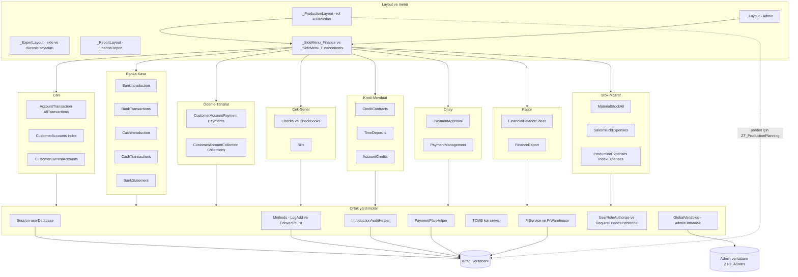
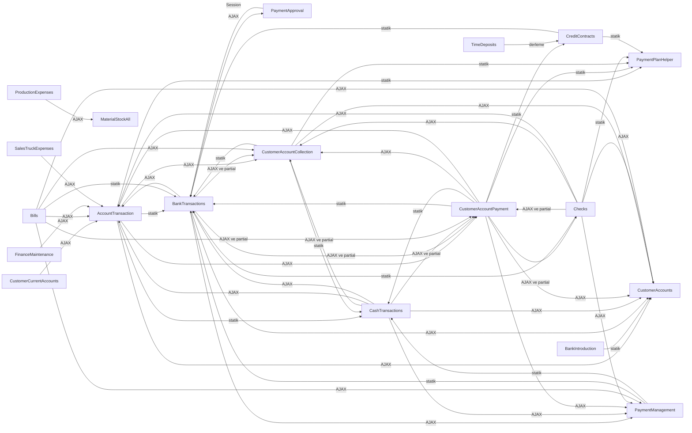
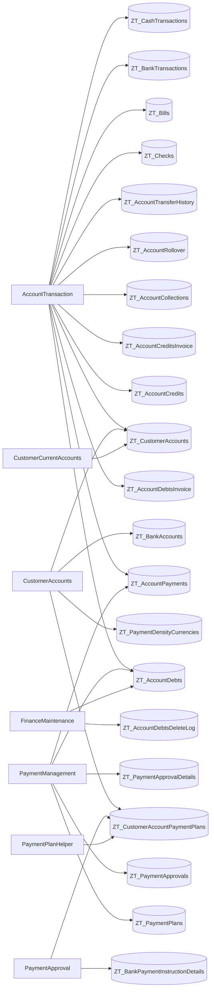
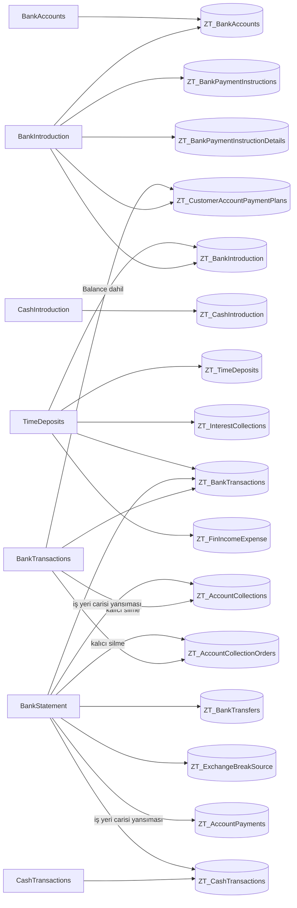
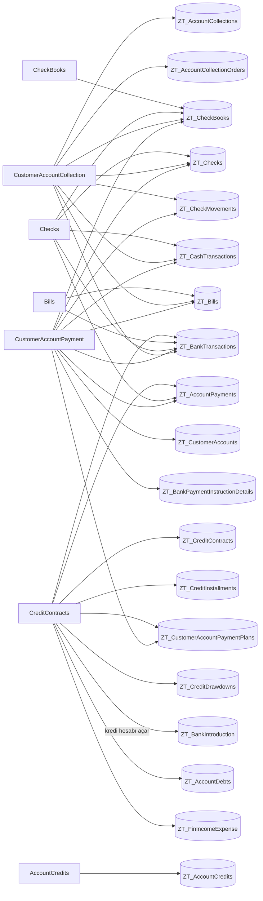
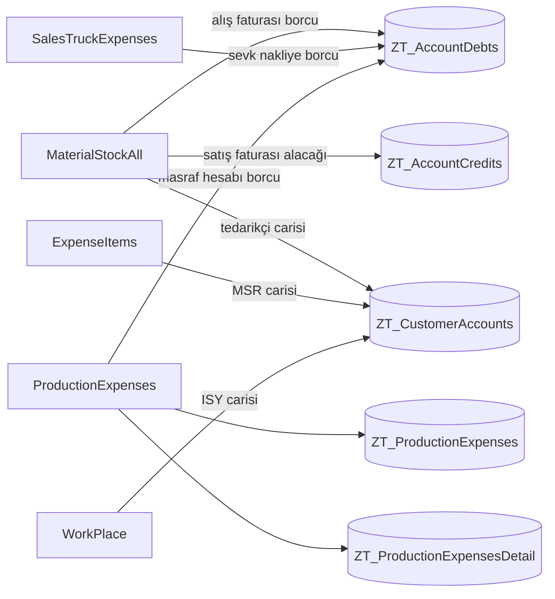
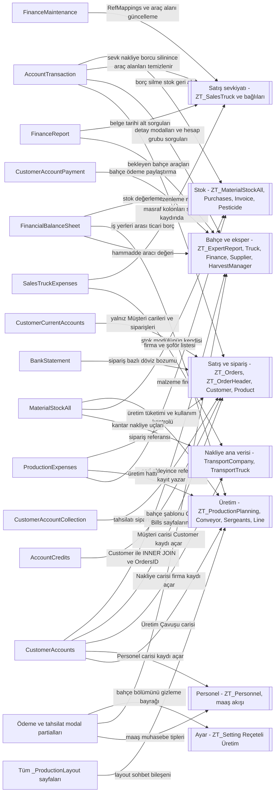
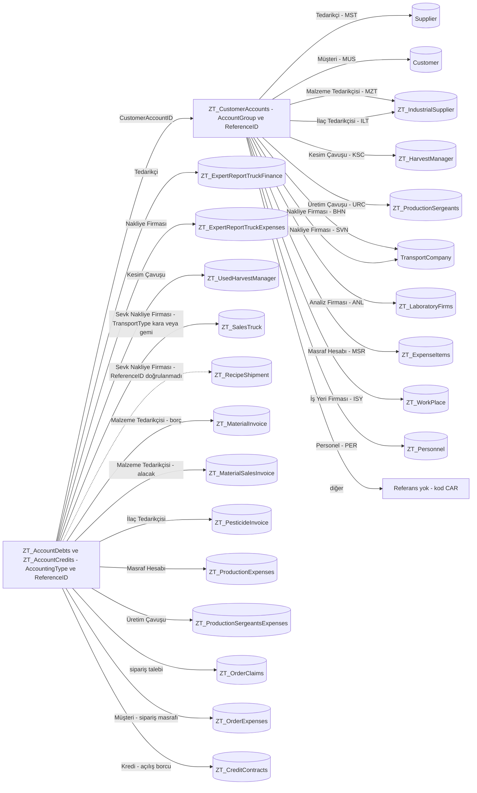
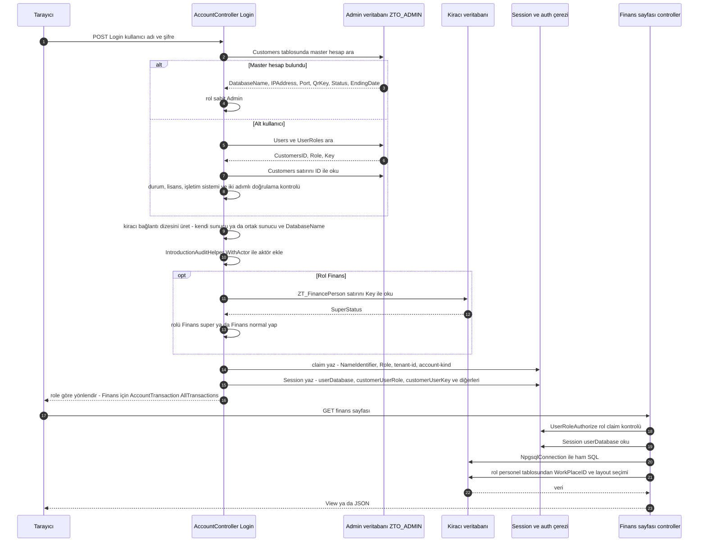

# Analiz 02 — Bağımlılık Grafiği

> **LogisticErp notu (2026-11-13):** Bu dosya ZTO Fabrika reposunda, `ZTO_LOGISTIC_Finans_Kopyalama_Promptu.md` için yazıldı ve buraya kopyalandı. O prompttaki K1 (.NET 8 MVC) ve K2 (kodu kopyala) kararları **geçersizdir**; geçerli yön `../00_README.md` ve `04_UYARLAMA_KARAR_MATRISI.md` §0. ZTO bulguları (tablolar, ekranlar, iş kuralları, satır referansları) geçerlidir; `f:\visual studio zto\ZtoFabrika2026\ZtoFabrika` kaynağına göredir.

> **Kapsam:** Faz 0.2 çıktısı. `01_FINANS_ENVANTER.md` tablolarının görsel karşılığıdır; tablo ve controller adları yalnızca [envanter/](envanter/) parçalarında geçenlerdir.
> **Görüntüleme:** VS Code Markdown önizlemesi (Mermaid eklentisi) ya da GitHub.

## 1. Katman görünümü

Okuma notu: Finans sayfalarının neredeyse tamamı rol kullanıcıları için `_ProductionLayout`, Admin için `_Layout` kullanır; ekle/düzenle sayfaları `_ExpertLayout`, FinanceReport ise menüsüz `_ReportLayout` ile çizilir. Sayfalar ayrı bir veri katmanı olmadan doğrudan kiracı veritabanına bağlanır; bağlantı dizesi Session `userDatabase` anahtarından gelir. Admin veritabanına yalnız `GlobalVeriables.adminDatabase` üzerinden, rol ve kiracı kaydı okumak için gidilir. Kesikli ok, layout'un her finans sayfasına dayattığı üretim tablosu bağımlılığıdır.

## 2. Finans controller'ları arası bağımlılık

Okuma notu: Ok yönü "çağıran → çağrılan" demektir; "statik" C# içinden statik metot çağrısı, "partial" başka controller'a ait modal partial'ının gömülmesi, "Session" iki controller'ın aynı Session anahtarını paylaşması, "derleme" başka controller dosyasındaki sınıflara derleme bağımlılığıdır. BankTransactions ve CashTransactions statik `CreateBankTransaction` / `CreateCashTransaction` metotlarıyla grubun ortak hareket yazıcılarıdır; bu iki controller ve PaymentPlanHelper kopyalanmadan ödeme, tahsilat, çek, senet ve kredi derlenmez. CustomerAccountPayment, CustomerAccountCollection, CustomerAccounts ve PaymentManagement uçları beş ayrı sayfaya gömülü ödeme ve tahsilat modalları üzerinden çağrılır; bu dörtlü bir arada taşınmalıdır. Yalnız bağlantı ve yönlendirme olan çağrılar çizilmedi.

## 3. Finans sayfası → çekirdek finans tabloları

### 3.1 Cari ve onay grubu

### 3.2 Banka, kasa ve mevduat grubu

### 3.3 Ödeme, tahsilat, çek, senet ve kredi grubu

### 3.4 Stok ve masraf grubu — çekirdek finans tablolarına yazma

Okuma notu: Yalnız yazma okları çizildi; okumalar gösterilmedi. Ok etiketi yoksa yazma türü INSERT, UPDATE ya da DELETE'in bir birleşimidir; ayrıntı bölüm 5'teki tablo kataloğundadır. Statik metotlar üzerinden yapılan dolaylı yazmalar, örneğin ödeme sayfasının `CreateBankTransaction` ile banka hareketi yazması, çağıran sayfaya bağlanarak gösterildi. Stok ve masraf grubunda yalnız çekirdek finans tablolarına giden oklar çizildi; stok tablolarına yazmalar bölüm 4'te.

## 4. Finans dışı bağımlılıklar

Okuma notu: Bu diyagram lojistiğe uyarlamada kesilmesi ya da dönüştürülmesi gereken bağların haritasıdır; her ok etiketi bağımlılığın nedenini söyler. En yaygın bağ layout'un üretim sohbet bileşenidir ve tek noktadan, layout'ta kesilebilir. En derin bağlar CustomerAccounts'un hesap grubuna göre ana veri tablolarına yazması, AccountTransaction'ın borç silme kuralları ve FinancialBalanceSheet'in stok blokları; bunlar kod düzeyinde yeniden yazım ister. Nakliye ana verisi kümesi lojistikte kesilmek yerine çekirdeğe dönüşebilecek tek gruptur.

## 5. Cari hesap polimorfik referans modeli

Okuma notu: Üst yarı cari kartın hangi ana veri tablosuna `AccountGroup` + `ReferenceID` çiftiyle bağlandığını, etiketteki üç harf hesap kodu önekini gösterir; veritabanında yabancı anahtar yoktur. Alt yarı borç ve alacak satırlarının kaynak belgeye `AccountingType` + `ReferenceID` çiftiyle bağlanmasıdır; `ReferenceID` tek başına benzersiz değildir ve sevk aracında aynı çift altında kara ve gemi için iki borç olabilir, ayrım `TransportType` ile yapılır. Kredi açılış borcundaki referansın sözleşme kimliği olduğu C parçasında açıkça yazmıyor, yalnız `AccountingType='Kredi'` ve belge türü verilmiş; kesikli ok doğrulanmamış bağı gösterir. Lojistik uyarlamasında en çok değişecek nokta bu iki eşleme listesidir.

## 6. Kimlik doğrulama ve kiracı çözümleme akışı

Okuma notu: Kiracı başına ayrı bir PostgreSQL veritabanı vardır ve kiracı girişte admin veritabanındaki `Customers` satırından çözülür; tam bağlantı dizesi Session `userDatabase` anahtarına yazılır ve her finans action'ı bağlantıyı oradan kurar. `WithActor` bağlantı dizesine kullanıcıyı ekler, kiracı veritabanındaki denetim tetikleyicisi bu değeri okur. Finans rolü girişte `ZT_FinancePerson.SuperStatus` değerine göre iki claim'e ayrılır; iş yeri kapsamı ise her sayfada rol personel tablosundan yeniden okunur ve sunucuda zorunlu filtre olarak uygulanmaz. Session boşken auth çerezi geçerliyse ara katman kullanıcıyı Login'e yönlendirir ve şifreli çerezlerden Session yeniden doldurulur; bu dal şemada gösterilmedi.
